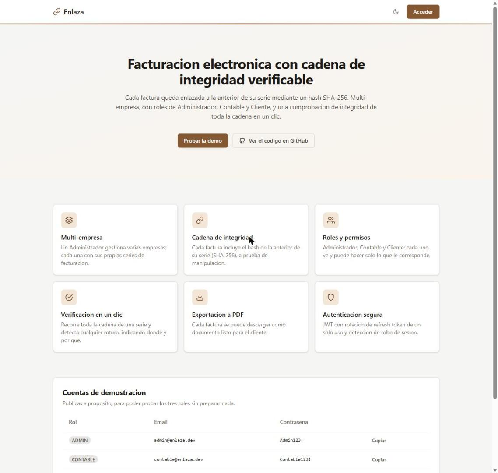
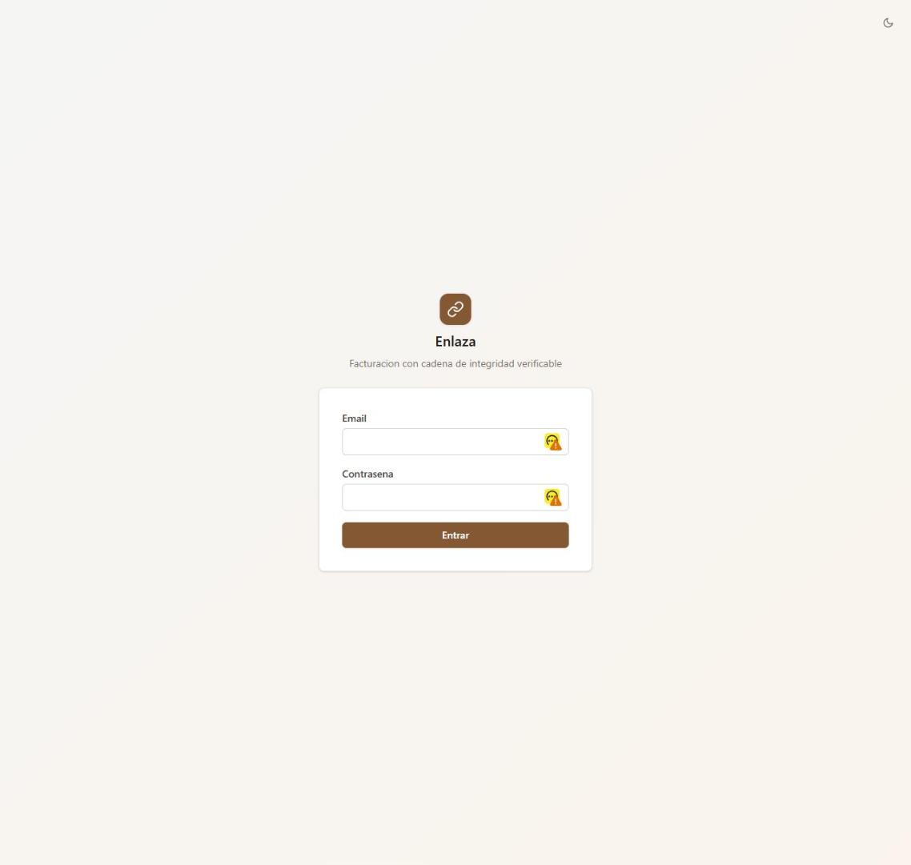
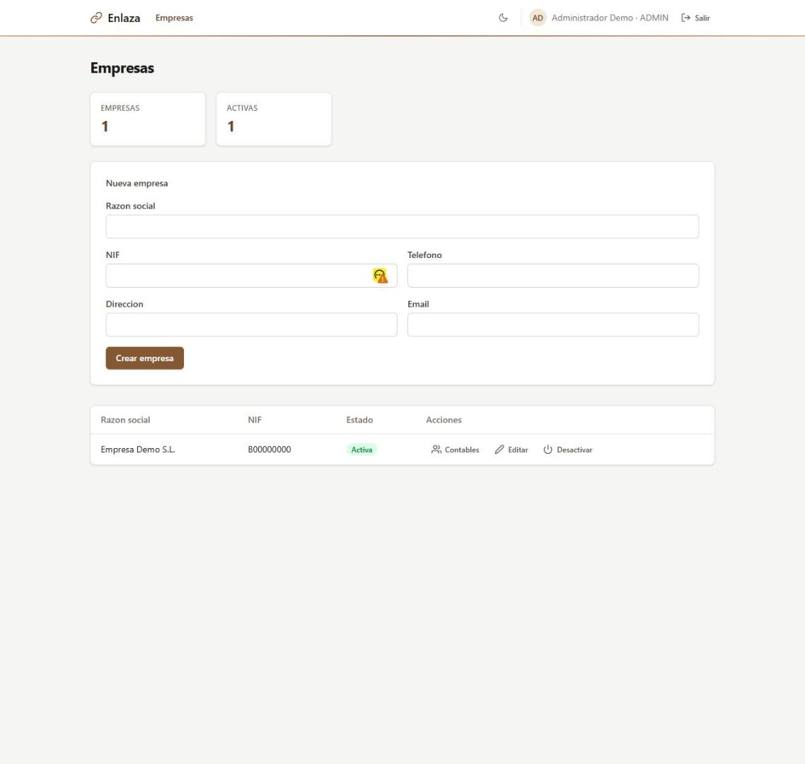
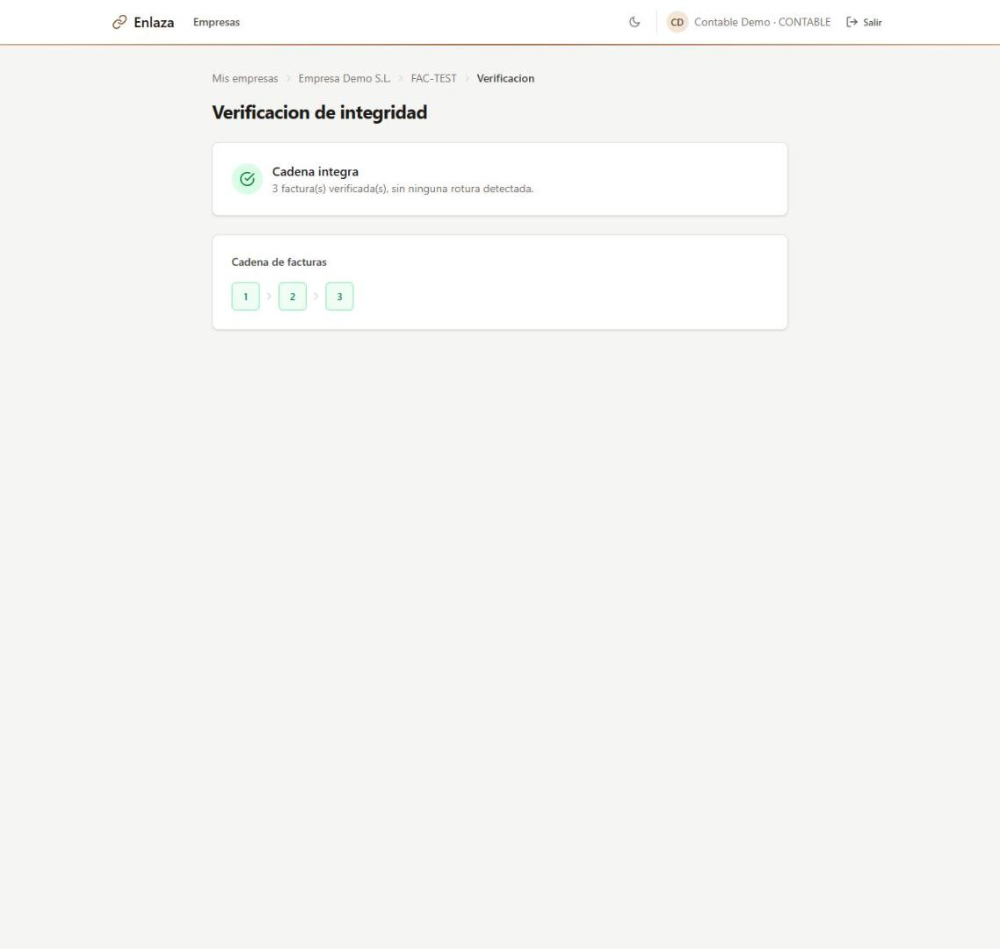
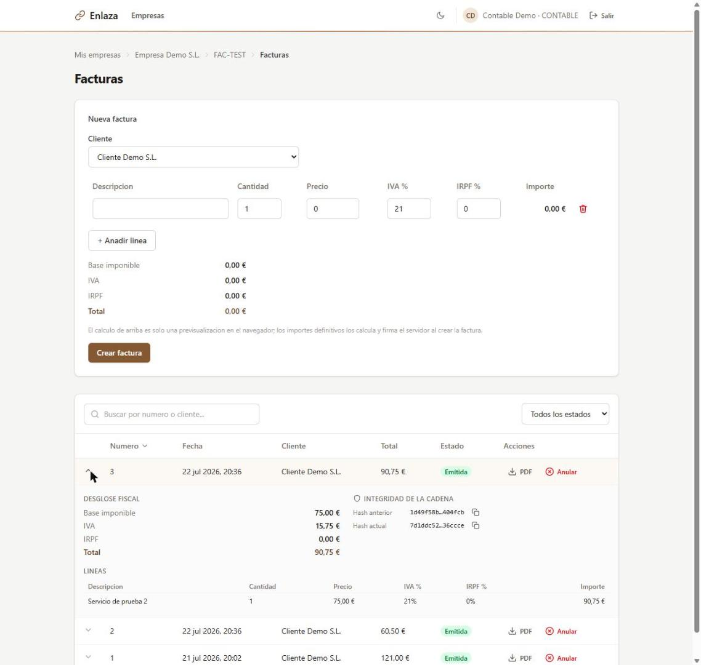
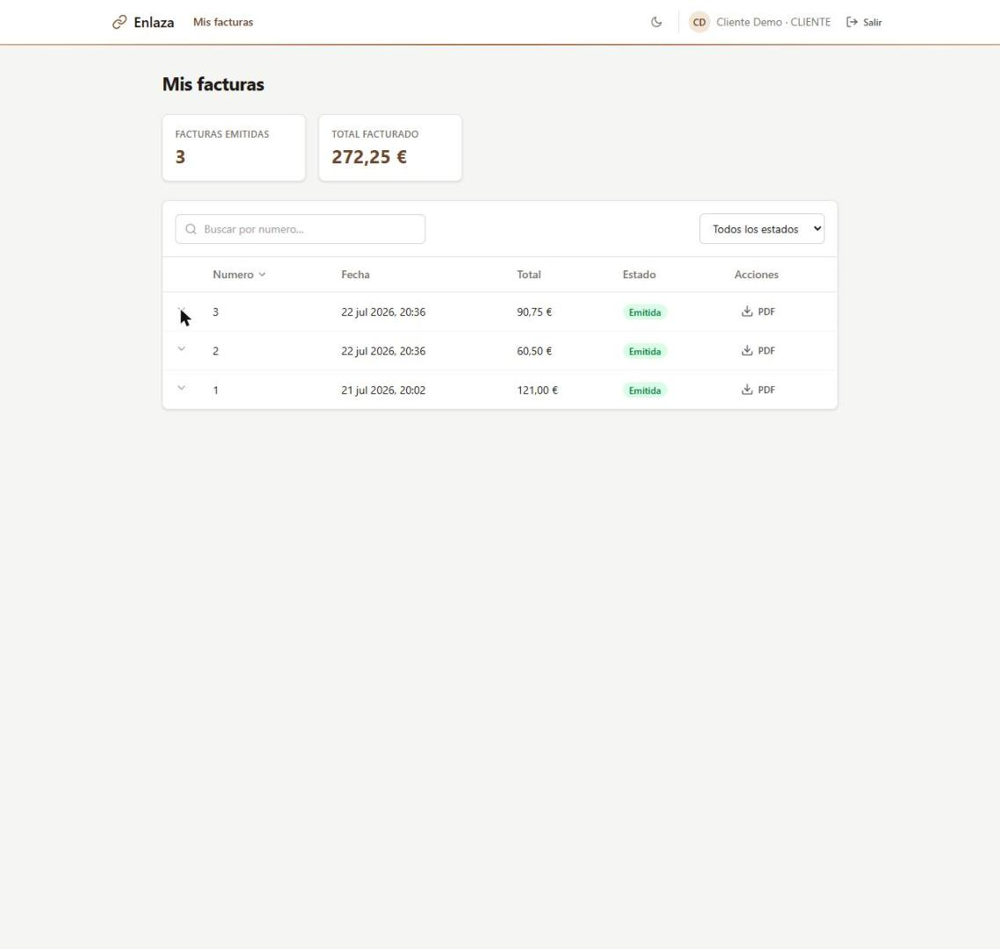

# Enlaza

Sistema de facturación electrónica multi-empresa con una **cadena de integridad verificable** entre facturas, inspirado en los requisitos técnicos de VeriFactu (España). El nombre viene de su mecanismo central: cada factura queda "enlazada" a la anterior de su serie mediante un hash SHA-256.

Proyecto de portfolio backend (junior/mid): pensado para parecer y funcionar como un sistema real de producción, no un ejercicio académico.

> ⚠️ Este proyecto es un ejercicio de portfolio y **no implementa ni certifica el cumplimiento legal de VeriFactu**. Está inspirado en sus requisitos técnicos (cadena de hashes, trazabilidad), no es una solución homologada.

## Demo en vivo

**https://enlaza-frontend.vercel.app**: pruébala con las [cuentas de demostración](#cuentas-de-demostración) (ADMIN, CONTABLE y CLIENTE).

> La demo corre íntegramente en planes gratuitos (Vercel + Render + Neon). Si nadie la ha usado en los últimos 15 minutos, el backend se duerme y **la primera petición tarda 30-60 s** en despertar; después responde con normalidad. La API está en `https://enlaza-api-th30.onrender.com/swagger-ui.html`.

## Núcleo técnico diferenciador

- **Multi-tenancy real**: un ADMIN gestiona varias Empresas; cada Empresa tiene sus propias Series de facturación, Clientes y Contables asignados.
- **RBAC con 3 roles**: `ADMIN` (todo), `CONTABLE` (crea/edita facturas de sus empresas asignadas), `CLIENTE` (solo lectura de sus propias facturas).
- **Numeración correlativa sin huecos**, con lock pesimista explícito para evitar condiciones de carrera en creación concurrente de facturas.
- **Cadena de hashes SHA-256** entre facturas consecutivas de una misma serie: cada factura incluye el hash de la anterior.
- **Endpoint de verificación de integridad**: recorre toda la cadena de una serie, recalcula cada hash de forma independiente y detecta la primera manipulación, indicando dónde y por qué.
- **Exportación de factura a PDF** (Thymeleaf + OpenHTMLtoPDF), descargable por ADMIN/CONTABLE y por el propio CLIENTE.
- **Autenticación JWT** con rotación de refresh token de un solo uso y detección de robo de sesión (reutilizar un token ya rotado revoca todas las sesiones del usuario).

## Capturas

| Landing pública | Inicio de sesión |
|---|---|
|  |  |

| Empresas (ADMIN) | Verificación de integridad (CONTABLE) |
|---|---|
|  |  |

**Facturas con desglose fiscal y hashes de la cadena** (fila expandible, disponible tanto para CONTABLE como para CLIENTE):



**Vista del rol CLIENTE** — solo sus propias facturas, mismo buscador/filtro/orden:



## Stack técnico

| Capa | Tecnología |
|---|---|
| Backend | Java 21 + Spring Boot 3.5.3, Maven |
| Persistencia | Spring Data JPA / Hibernate + PostgreSQL 16, Flyway (migraciones versionadas) |
| Seguridad | Spring Security 6 + JWT (`jjwt` 0.12.x) — access token JWT, refresh token opaco hasheado en BD |
| API docs | springdoc-openapi 2.8.6 (Swagger UI, esquema Bearer) |
| Observabilidad | Spring Boot Actuator, solo `/actuator/health` expuesto (público, sin detalles internos) — pensado para el healthcheck de la plataforma de despliegue |
| PDF | Thymeleaf (solo para generar el HTML de la factura) + OpenHTMLtoPDF |
| Frontend | JavaScript vanilla (módulos ES nativos, sin bundler ni TypeScript) + Tailwind CSS v4, servido por su propio `nginx` — nunca por Spring Boot |
| Testing | JUnit 5 + Mockito + Testcontainers (Postgres real, nunca H2), 81 tests de integración/unitarios |
| Contenerización | Docker + docker-compose (`app`, `postgres`, `frontend`) |

## Arquitectura y decisiones de diseño

El modelo de datos completo (entidades, diagrama entidad-relación, y las 10 decisiones técnicas no triviales del proyecto — UUID vs. autoincremental, por qué `Empresa` no tiene `owner`, cómo se garantiza la numeración atómica, etc.) está documentado en [`docs/01-modelo-datos.md`](docs/01-modelo-datos.md).

## Ejecutar en local

Requisito: Docker y Docker Compose.

```bash
cp .env.example .env
# .env.example ya trae un JWT_SECRET funcional y contraseñas demo — válido para probar
# en local, pero rótalos antes de exponer cualquier instancia con datos reales.

docker-compose up --build
```

- Backend: http://localhost:8080 (Swagger UI en `/swagger-ui.html`)
- Frontend: http://localhost:8081

### Cuentas de demostración

Sembradas automáticamente al arrancar (`DemoDataSeeder`), para poder probar los tres roles sin preparar nada a mano:

| Rol | Email | Contraseña |
|---|---|---|
| ADMIN | `admin@enlaza.dev` | `Admin123!` |
| CONTABLE | `contable@enlaza.dev` | `Contable123!` |
| CLIENTE | `cliente@enlaza.dev` | `Cliente123!` |

## Documentación de la API

- **Swagger UI**: http://localhost:8080/swagger-ui.html (con la app levantada). Incluye el botón "Authorize" para pegar un Bearer token y probar los endpoints protegidos directamente desde el navegador.
- **Colección Postman**: [`docs/postman/Enlaza.postman_collection.json`](docs/postman/Enlaza.postman_collection.json). Incluye variables de colección (`baseUrl`, `accessToken`, `empresaId`...) que se rellenan solas al ejecutar los requests de login y creación, así que se puede correr de principio a fin sin editar nada a mano.

## Tests

Requiere JDK 21, Maven y Docker corriendo (Testcontainers levanta un Postgres real para cada clase de test, nunca usa H2 en memoria):

```bash
mvn test
```

81 tests (unitarios + integración contra Postgres real vía Testcontainers, nunca H2). Cubren, entre otros: numeración concurrente de facturas (10 hilos simultáneos sobre la misma serie), rotación y reutilización de refresh tokens, cálculo de impuestos, y verificación de integridad de la cadena de hashes.

## Despliegue

Desplegado en Render (backend, Docker), Neon (Postgres) y Vercel (frontend estático), todo en capa gratuita. Checklist completo (Render para el backend, Vercel para el frontend, qué variables de entorno rotar y cuáles no) en [`docs/02-despliegue.md`](docs/02-despliegue.md).

## Límites de alcance (decisiones deliberadas, no huecos olvidados)

- **Sin gestión de usuarios desde la UI.** El alta de usuarios (ADMIN/CONTABLE/CLIENTE) se apoya deliberadamente en los usuarios semilla del `DemoDataSeeder`. La pantalla de Contables de un ADMIN es de solo lectura + "quitar" — no existe (ni se añadió) un endpoint para crear usuarios nuevos desde la API, porque construir una UI para una funcionalidad que no existe en el backend habría sido alcance añadido sin valor real para el propósito de portfolio del proyecto.
- **Sin certificación VeriFactu real.** Ver aviso al inicio de este documento.
- **Sin borradores de factura.** Una factura solo puede estar `EMITIDA` o `ANULADA`; anular no borra ni renumera, preserva su hash. Ver decisión D7 en `docs/01-modelo-datos.md`.
- **Sin tabla de auditoría (`AuditLog`).** Está diseñada en [`docs/01-modelo-datos.md`](docs/01-modelo-datos.md) (decisión D8) pero no implementada: la integridad de las facturas ya la garantiza la cadena de hashes, y registrar quién cambió qué sería ampliar el alcance, no completar el núcleo.

- **Sin autenticación social ni recuperación de contraseña por email.** Fuera del núcleo técnico que el proyecto quiere demostrar (multi-tenancy, RBAC, cadena de integridad); habría añadido infraestructura de correo sin aportar a ese objetivo.

## Estructura del repositorio

```
src/               Backend Spring Boot (package-by-feature: usuario, empresa, cliente, serie, factura, security...)
frontend/          Frontend estático (JS vanilla + Tailwind), servicio nginx propio en local, Vercel en despliegue
docs/
  01-modelo-datos.md         Modelo de datos y decisiones técnicas (Fase 1)
  02-despliegue.md           Checklist de despliegue (Fase 10)
  images/                    Capturas usadas en este README
  postman/                   Colección Postman
docker-compose.yml           app + postgres + frontend (entorno local)
```
