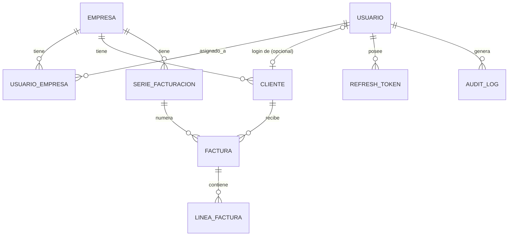

# Fase 1 — Modelo de datos

> Estado: propuesta pendiente de confirmación. No hay código todavía (por diseño: el modelo se cierra antes de escribir la primera línea de Java).

## 1. Entidades

### Usuario
Credencial de acceso al sistema (login). No confundir con `Cliente` (ver más abajo).

| Campo | Tipo | Notas |
|---|---|---|
| id | UUID (PK) | |
| email | String | único |
| passwordHash | String | BCrypt |
| nombre | String | |
| role | enum: `ADMIN`, `CONTABLE`, `CLIENTE` | |
| clienteId | UUID (FK → Cliente, nullable) | solo se rellena si `role = CLIENTE` |
| enabled | boolean | |
| createdAt / updatedAt | Instant | |

### Empresa
Entidad fiscal gestionada por el sistema (el "tenant" del negocio).

| Campo | Tipo | Notas |
|---|---|---|
| id | UUID (PK) | |
| razonSocial | String | |
| nif | String | único |
| direccion | String | |
| email / telefono | String | |
| activa | boolean | |
| createdAt / updatedAt | Instant | |

### UsuarioEmpresa
Tabla de asignación N—M: qué CONTABLEs pueden operar sobre qué Empresas.

| Campo | Tipo | Notas |
|---|---|---|
| id | UUID (PK) | |
| usuarioId | UUID (FK → Usuario) | |
| empresaId | UUID (FK → Empresa) | |
| fechaAsignacion | Instant | |
| — | — | unique(usuarioId, empresaId) |

### Cliente
El tercero al que una Empresa factura. Dato fiscal, no credencial.

| Campo | Tipo | Notas |
|---|---|---|
| id | UUID (PK) | |
| empresaId | UUID (FK → Empresa) | |
| nombre | String | |
| nif | String | |
| direccion / email | String | |
| createdAt / updatedAt | Instant | |

### SerieFacturacion
Serie de numeración de una Empresa (ej: "A", "F2026").

| Campo | Tipo | Notas |
|---|---|---|
| id | UUID (PK) | |
| empresaId | UUID (FK → Empresa) | |
| codigo | String | unique(empresaId, codigo) |
| ultimoNumero | int | último número emitido en la serie |
| ultimoHash | String | hash de la última factura emitida (semilla inicial: hash "génesis") |
| activa | boolean | |
| createdAt | Instant | |

### Factura
| Campo | Tipo | Notas |
|---|---|---|
| id | UUID (PK) | |
| serieId | UUID (FK → SerieFacturacion) | |
| numero | int | unique(serieId, numero); correlativo, sin huecos |
| fechaEmision | Instant | |
| clienteId | UUID (FK → Cliente) | |
| estado | enum: `EMITIDA`, `ANULADA` | ver decisión D7 |
| hashAnterior | String | copia del hash de la factura anterior de la serie |
| hashActual | String | SHA-256 de campos inmutables + hashAnterior |
| baseImponible / totalIva / totalIrpf / total | BigDecimal(19,2) | |
| creadoPor | UUID (FK → Usuario) | |
| createdAt / updatedAt | Instant | |

### LineaFactura
| Campo | Tipo | Notas |
|---|---|---|
| id | UUID (PK) | |
| facturaId | UUID (FK → Factura) | |
| descripcion | String | |
| cantidad | BigDecimal | |
| precioUnitario | BigDecimal(19,2) | |
| porcentajeIva | BigDecimal | configurable por línea, no hardcodeado |
| porcentajeIrpf | BigDecimal | configurable por línea, puede ser 0 |
| importeBase / importeIva / importeIrpf / importeTotal | BigDecimal(19,2) | calculados |

### RefreshToken
| Campo | Tipo | Notas |
|---|---|---|
| id | UUID (PK) | |
| usuarioId | UUID (FK → Usuario) | |
| token | String | hash del token, no el valor en claro |
| expiryDate | Instant | |
| revoked | boolean | |
| createdAt | Instant | |

### AuditLog
| Campo | Tipo | Notas |
|---|---|---|
| id | UUID (PK) | |
| entidad | String | ej. "Factura" |
| entidadId | UUID | |
| accion | enum: `CREATE`, `UPDATE`, `DELETE` | |
| usuarioId | UUID (FK → Usuario) | actor |
| timestamp | Instant | |
| detalle | JSON/text | snapshot o diff, opcional en el MVP |

## 2. Diagrama entidad-relación

Relaciones en texto:

- `Empresa` 1—N `SerieFacturacion`
- `Empresa` 1—N `Cliente`
- `Empresa` N—M `Usuario` (vía `UsuarioEmpresa`, solo relevante para rol `CONTABLE`)
- `SerieFacturacion` 1—N `Factura`
- `Cliente` 1—N `Factura`
- `Factura` 1—N `LineaFactura`
- `Usuario` 1—0..1 `Cliente` (acceso de portal, solo rol `CLIENTE`)
- `Usuario` 1—N `RefreshToken`
- `Usuario` 1—N `AuditLog` (como actor)

## 3. Decisiones técnicas no triviales

**D1. Frontend: JavaScript + Tailwind consumiendo la API vía `fetch`, no Thymeleaf.**
Mantiene el backend como protagonista: una API REST pura, documentable con Swagger y testeable con Postman/tests de integración, sin lógica de presentación mezclada en el mismo proceso Spring. Es además el patrón más cercano a lo que se espera demostrar en una entrevista backend (separación cliente/servidor).

**D2. UUID como PK en lugar de `Long` autoincremental.**
Evita ataques de enumeración sobre entidades sensibles (facturas, empresas, clientes) en un sistema multi-tenant, y desacopla la identidad técnica del volumen de negocio (nadie debe poder inferir cuántas facturas ha emitido una empresa a partir de un ID secuencial). El número de factura (`numero`), que sí debe ser correlativo y visible, se modela aparte como campo de negocio.

**D3. `Empresa` sin campo `owner`; el acceso se resuelve por rol + tabla de asignación.**
El requisito dice "ADMIN gestiona todo", no "ADMIN gestiona las empresas que creó". Modelar un `owner` añadiría una regla de negocio no pedida. El acceso se resuelve en la capa de seguridad (rol + `UsuarioEmpresa`), no en el modelo de datos, que queda más simple.

**D4. `Cliente` como entidad separada de `Usuario`.**
Un `Cliente` (el tercero al que se factura) es un dato fiscal, no una credencial; no todos los clientes de una empresa necesitan acceso al portal. Separar ambos conceptos evita forzar la creación de un `Usuario` por cada cliente y permite añadir el acceso de portal (`Usuario.clienteId`) de forma opcional.

**D5. `numero` y `hashActual` se asignan atómicamente en la creación, bajo lock sobre `SerieFacturacion`.**
Es el punto exacto de riesgo de condición de carrera: dos peticiones concurrentes pidiendo el "siguiente número" de la misma serie. Bloquear la fila de `SerieFacturacion` (`PESSIMISTIC_WRITE`) dentro de la misma transacción que crea la `Factura` garantiza numeración sin huecos y sin duplicados, sin necesitar una tabla de secuencias externa.

**D6. `ultimoHash` se guarda en `SerieFacturacion`, no se recalcula consultando la última `Factura`.**
Al bloquear la fila de la serie para obtener el siguiente número, ya se dispone —bajo el mismo lock— del hash anterior necesario para encadenar la nueva factura. Evita una segunda consulta (y una segunda ventana de carrera) para leer la última factura de la serie.

**D7. Estado de `Factura`: solo `EMITIDA` / `ANULADA`, sin borradores.**
El alcance pedido no incluye un flujo de borrador; añadirlo introduciría numeración condicional (¿cuándo se asigna el número?) fuera de lo solicitado. Una factura anulada conserva su número y su hash — igual que en un sistema fiscal real, no se borra ni se renumera.

**D8. Auditoría con `@EntityListeners` + tabla `AuditLog` genérica, no event sourcing.**
Event sourcing rediseñaría toda la persistencia alrededor de eventos/aggregates, un esfuerzo desproporcionado para el alcance y que diluiría el foco del proyecto (la cadena de hashes). `@EntityListeners` (`@PrePersist`/`@PreUpdate`) capturando snapshots en `AuditLog` cumple el requisito sin salir del modelo JPA convencional del resto del proyecto.

**D9. `BigDecimal` con escala fija (2 decimales, `RoundingMode.HALF_UP`) para todos los importes.**
En un sistema financiero, usar `double`/`float` es un error de correctitud (errores de redondeo binario), no de estilo. `BigDecimal` es el estándar de facto en Java para dinero.

**D10. Hash con SHA-256 sobre campos inmutables de la factura + `hashAnterior`.**
Determinista, resistente a colisiones, disponible en la librería estándar de Java (`MessageDigest`) sin dependencias extra — el mismo tipo de mecanismo de huella encadenada que usa VeriFactu para garantizar la integridad de los registros de facturación.

## 4. Fuera de alcance (explícitamente)

- Autenticación social (Google/Facebook).
- Flujo de borrador de factura.
- Facturas rectificativas / abonos como entidad propia.
- Cualquier promesa de cumplimiento legal real de VeriFactu: este sistema está *inspirado en* sus requisitos técnicos, no lo certifica.
